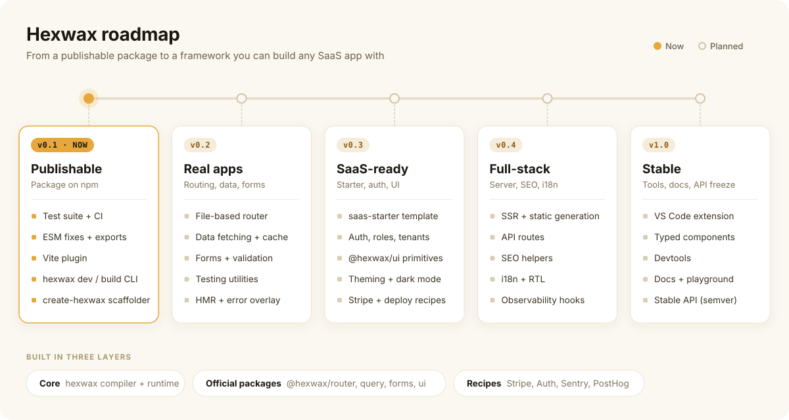

<p align="center">
  
</p>

<h1 align="center">Hexwax</h1>

<p align="center">
  <b>A UI compiler that disappears at build time.</b><br>
  Build fast, tiny web apps with plain HTML, CSS and JavaScript —
  no virtual DOM, no framework runtime shipped to the browser.
</p>

<p align="center">
  <a href="https://anupam42.github.io/hexwax/">Documentation</a> ·
  <a href="#example">Example</a> ·
  <a href="#why-hexwax-when-there-are-already-so-many-frameworks">Why Hexwax?</a> ·
  <a href="#product-roadmap--a-saas-ready-framework">Roadmap</a>
</p>

---

## What is Hexwax?

Hexwax is a **compiler-based UI framework**. You write components as single files of
standard HTML, CSS and JavaScript. At build time the compiler reads each component once
and turns it into the small, direct DOM code you would otherwise write by hand. What ships
to the browser is your app — not a framework.

* **High performance** — no virtual DOM diffing, no proxies; only the DOM that actually changed is touched
* **Fast startup** — among the best startup metrics, because there's almost nothing to boot
* **Tiny bundles** — an app starts from **185 bytes**
* **Familiar syntax** — if you know HTML, CSS and JavaScript, you already know most of Hexwax
* **Batteries when you need them** — stores, transitions, scoped CSS, slots, portals and more, all built in

> **The name.** *Hexwax* is the hexagonal wax of a honeycomb. Bees build one of nature's
> most efficient structures out of small, identical cells — that's the idea: small
> components, compiled into one efficient app, with nothing extra left over.

## Why Hexwax, when there are already so many frameworks?

There's no shortage of front-end frameworks — React, Vue, Angular, Svelte, Solid and many more.
Hexwax exists because of a gap between them, not to replace them:

1. **Most apps ship a framework to every user.** Runtime-based frameworks (React, Vue, Angular)
   send their virtual DOM and scheduler to the browser before your app does anything. That
   cost is paid on every page load, on every device — and it hurts most on the slow phones
   and networks many real users have.
2. **Compilers proved there's a better way — but stopped at the UI layer.** Svelte showed that
   moving work to build time produces faster, smaller apps. But building a real product still
   means assembling routing, data fetching, forms, auth and deployment from many unrelated
   libraries and making them fit.
3. **The learning curve keeps growing.** Hooks rules, dependency arrays, signals, proxies,
   new file formats and new mental models — each framework adds its own. Developers spend
   time learning the framework instead of building the product.

**The idea behind Hexwax:** combine the *smallest possible output* of a compiler with a
*complete, official path to a production app*.

* **Keep the core tiny.** The compiler does the work; the runtime stays a few hundred bytes.
* **Stay close to the platform.** Plain HTML, CSS and JavaScript; `count++` updates the UI — no `setState`, no hooks rules.
* **Provide the full journey, opt-in.** Official packages for routing, data, forms and UI, plus
  recipes for auth, billing and monitoring — so a team can go from `npm create hexwax` to a
  production SaaS app without stitching ten libraries together (see the [roadmap](#product-roadmap--a-saas-ready-framework)).
* **Never lock you in.** Vendors (Stripe, Auth0, Sentry …) are recipes, not dependencies.

### How it compares

|                         | React / Vue / Angular          | Svelte                     | **Hexwax**                                   |
| ----------------------- | ------------------------------ | -------------------------- | --------------------------------------------- |
| Approach                | Runtime framework              | Compiler                   | **Compiler**                                  |
| Virtual DOM             | Yes (React, Vue)               | No                         | **No**                                        |
| Framework code shipped  | Large runtime                  | Small runtime              | **Minimal runtime (apps from 185 bytes)**     |
| Component syntax        | JSX / templates / decorators   | `.svelte` files + runes    | **Standard HTML, CSS, JS**                    |
| Reactivity              | Hooks / proxies / signals      | Runes (signals)            | **Plain assignment (`count++`)**              |
| Path to a full SaaS app | Many third-party libraries     | SvelteKit                  | **Official packages + recipes (in progress)** |

### Who it's for

* Teams building **SaaS products, dashboards and admin tools** who care about load time and bundle size
* Developers who want to **write web standards**, not learn a new dialect
* Projects that need to **embed fast widgets** into existing sites

### Project status

Hexwax is **pre-release** and not yet published to npm. The compiler and runtime work today
(see [Features](#features)); the current focus is making it publishable — see the
[publishing plan](#publishing-to-npm--release-plan) and the
[roadmap diagram](#roadmap-at-a-glance).

## Example

```html
<script>
  let name = 'world';
    
  function rename() {
    name = 'user';
  }
</script>

<h1>Hello {name.toUpperCase()}!</h1>
<button @click={rename}>Rename</button>
```

## How it works

Hexwax is a compiler. `src/main.js` exposes `compile(source, config)`, which runs a
component's `.html`-style source through a pipeline and returns a plain JS module string:

```
source
  │
  ├─ src/parser.js          parseHTML(): markup → DOM-ish AST; parseText(): {expr} interpolation
  ├─ src/compact.js          collapses whitespace-only text nodes
  ├─ src/code.js              parses the <script> block (acorn) and detects root
  │                          variables/functions, imports, reactive (`$:`) statements
  ├─ src/css/index.js        scopes <style> CSS to the component
  ├─ src/xnode.js             dependency-resolving code builder (xNode/xBuild) — nodes
  │                          declare what they `$wait` on / `$hold`, and building
  │                          resolves in the right order regardless of declaration order
  ├─ src/builder.js           walks the template AST, emitting xNodes for each construct
  │     └─ src/parts/*.js     one file per construct: if, each, await, html, component,
  │                          slot, fragment, head, portal, keep-alive, prop, radio, select
  ├─ src/event-prop.js        compiles `@event` bindings + modifiers (stop/prevent/keys)
  └─ src/runtime/*.js         what the emitted code imports at runtime:
        ├─ cd.js               change-detector tree + $digest() dirty-checking loop
        ├─ base.js              DOM primitives, makeComponent/mount, dynamic components,
        │                      slots, actions, class/style bindings, spread props
        ├─ share.js             current-component/current-cd context plumbing
        └─ index.js             barrel export consumed as `hexwax/runtime.js`
```

Distribution entry points:
- `hexwax.js` / `hexwax.mjs` — the compiler, built via `rollup -c` (see `rollup.config.js`)
- `hexwax-rollup.js` — Rollup plugin wrapping the compiler for `.html`/component imports
- `hexwax-esbuild.js` — esbuild plugin doing the same
- `runtime.js` — the runtime bundle every compiled component imports
- `plugins/sass.js`, `plugins/static-text.js` — optional compiler plugins (hook into
  `dom:before`/`css:before`/etc. lifecycle hooks in `compiler.js`)

### Reactivity model

Reactivity is assignment-driven but resolved via a **digest loop**, not static
per-assignment analysis: every `@event` handler is compiled to call the local handler
and then `$$apply()`, e.g.

```js
$runtime.addEvent(el, 'click', ($event) => { rename(); $$apply(); });
```

`$$apply()` schedules a microtask that runs `$digest($cd)`, walking the change-detector
tree and re-evaluating every registered watcher's getter (`$watch(fn, cb)`); a changed
value fires the callback (DOM update, prop push to a child component, store write, etc.).

## Features

### Reactivity
* Assignment-driven reactivity (`name = 'user'`) — no virtual DOM, no proxies
* Reactive statements with `$:` (compiled to a `prefixPush`-scheduled watch, `code.js`)
* Explicit watchers: `$watch(fn, callback, lvl)`
* `immutable` option and deep checking (`prop|deep`, `deepCheckingProps`)
* Stores with autosubscription (`!no-autosubscribe` to opt out) — any lowercase-named
  import with a `.subscribe(fn)` method is wired to re-run the digest on change
* Store helpers `writable`/`readable`/`derived` (`src/store.js`, exported from
  `hexwax/runtime.js`) implementing that `.subscribe()` contract so you don't have
  to hand-roll it

### Template blocks
* Conditionals: `#if`, `:else`, `:else-if`
* Loops: `#each` with index, destructuring, `key`/`auto` key, and `each-else`
* Async: `#await` / `:then` / `:catch`
* `@html` raw HTML output
* Fragments, exported fragments (inverted slots)
* Slots, named slots, fragment slots
* Dynamic components and `hexwax:self`
* `<hexwax:head>`, `<hexwax:body>`, `<hexwax:window>`
* Portals (`<hexwax:portal>`)
* `keep-alive` blocks

### Bindings, events & directives
* Event shortcuts (`@click`) and forwarding (`@@click`, forward all `@@`)
* Manual delegation `@click|root`
* Event modifiers: `stop`, `prevent`, `ctrl`, `alt`, `shift`, `meta`
* Key events: `enter`, `tab`, `esc`, `space`, arrow keys, `delete`
* Two-way bindings, incl. `radio`, `select`, `range`/`number` (value as number)
* Actions (`use:`), inline actions, actions returning a destroy function
* Transitions: `transition:`/`in:`/`out:` directives (`src/parts/transition.runtime.js`)
  with a built-in `fade`/`fly`/`scale`/`slide` library. Outro transitions hook into
  the existing `share.destroyResults` mechanism that `#if`/`#each` already used for
  async destroy — no changes needed to their mount/unmount logic to make this work
* Spread props and objects `{...obj}`
* `$props`, `$attributes`, `$restProps`
* `export const` constant props, `export function`
* Context API (`$context`)
* Autoimport

### Styling
* Scoped CSS by default
* `:global` selectors and `global` style attribute
* Compound classes and passing CSS classes to child components
* External classes (`$className`)
* `style:` templates (e.g. `style:color={color}`)

### Lifecycle
* `onMount`, `onDestroy`, `$onMount`, `$onDestroy`
* `onError`, `tick`

### Tooling
* Rollup plugin (`hexwax-rollup.js`)
* esbuild plugin (`hexwax-esbuild.js`)
* sass/scss and static-text plugins
* Compiler plugin hooks: `dom:before`, `dom`, `dom:check`, `dom:compact`, `dom:after`,
  `js:before`, `js`, `js:after`, `css:before`, `css`, `runtime:before`, `runtime`,
  `build:before`, `build` (see `hook()` in `src/main.js`)

## Next up (near-term priority)

These were picked as the highest-leverage additions for day-to-day app building —
what devs reach for constantly in Svelte-like frameworks, more than any of the
longer-tail roadmap items below. Turned out most of this list was already built
into the compiler/runtime we inherited; verified each by actually compiling and
running a component, not just reading the source:

- [x] **`$:` reactive statements** — already implemented (`code.js`, `LabeledStatement`
  with label `$` → compiled to a `prefixPush`-scheduled watch). Verified: compiles and
  updates a derived value when its dependency changes.
- [x] **Actions (`use:`)** — already implemented (`parts/prop.js` → `$runtime.bindAction`,
  `runtime/base.js`). Verified: compiles and runs on element mount.
- [x] **Stores** — the `.subscribe()` autosubscription mechanism already existed
  (`builder.js`/`runtime/base.js`); added the missing piece, `writable`/`readable`/
  `derived` helpers (`src/store.js`) implementing that contract. Verified: a
  `writable` counter updates a bound template expression through a real click event.
- [x] **Transitions (`transition:`/`in:`/`out:`)** — genuinely new. Added parser/compiler
  support (`parts/prop.js`) and a runtime tween engine + `fade`/`fly`/`scale`/`slide`
  library (`parts/transition.runtime.js`). Outro transitions plug into the
  `share.destroyResults` mechanism `#if`/`#each` already use to defer async destroy —
  no changes needed to their mount/unmount logic. Verified: an outro-faded `<p>` stays
  in the DOM until its transition's `duration` elapses, then is removed.
- [ ] **TypeScript (`<script lang="ts">`)** — not started. Plan: type erasure only —
  strip types at compile time via the `typescript` package's `transpileModule`, then
  feed the resulting plain JS into the existing `code.js`/acorn pipeline unchanged.
  No in-compiler type-checking (that's a much larger, slower feature — left as a
  separate, lower-priority roadmap item below); real type-checking stays the
  editor's/`tsc`'s job, same as Svelte/Vue SFCs.

Known rough edge from this pass: the `autoSubscribe` heuristic treats *any*
lowercase-first-letter import as a store candidate (checked for a `.subscribe`
method at runtime, so it's harmless, just slightly wasteful) — e.g. importing
`fade`/`writable` themselves triggers a no-op `autoSubscribe()` call. Not worth
fixing now; noted here so it isn't mistaken for a new bug later.

## Publishing to npm — release plan

Status from a project review (2026-11-15): **the package is not publishable yet.**
`npm pack --dry-run` currently produces a 6-file tarball containing only `package.json`,
the readme, the two bundler plugins and the two compiler plugins — **no compiler and no
runtime**, because `hexwax.js` / `hexwax.mjs` / `runtime.js` are gitignored build output and
nothing builds them before packing. The package name `hexwax` is still free on npm.
Work through the phases in order; each phase should leave `main` releasable.

### Phase 0 — Fix blockers (must be done before any publish)
- [ ] Run `npm install` and confirm `npm run build` produces `hexwax.js`, `hexwax.mjs`, `runtime.js`
  (right now the build fails with `rollup: command not found` on a fresh checkout without deps)
- [ ] Create the missing test suite: `npm test` points at `./test/run.js`, but there is no
  `test/` directory. Add a mocha + jsdom harness that compiles fixture components and
  asserts on rendered DOM (cover at least: text binding, `@click`, `#if`, `#each`, `#await`,
  slots, stores, transitions, scoped CSS)
- [ ] Add the missing `LICENSE` file (MIT) — the readme links to it but it doesn't exist
- [ ] Unify the version: `package.json` says `0.0.1` but `src/compiler.js` hard-codes
  `version = '0.8.0-a3'`. Make `package.json` the single source (e.g. import it in
  `rollup.config.js` and inject via `@rollup/plugin-replace`)
- [ ] Fix module format of `hexwax-esbuild.js`, `plugins/sass.js`, `plugins/static-text.js`:
  they use `require` / `module.exports` but the package is `"type": "module"`, so Node
  will throw when they are loaded. Convert to ESM (or rename to `.cjs` and ship both)
- [ ] Fix `hexwax-esbuild.js` importing `require('hexwax')` — that resolves to `main`
  (`runtime.js`), not the compiler. It should import `hexwax/hexwax.mjs` like `hexwax-rollup.js` does
- [ ] Add `"prepublishOnly": "npm run build && npm test"` so a publish can never ship
  without the compiled files
- [ ] Declare optional integrations as `peerDependencies` + `peerDependenciesMeta.optional`:
  `esbuild`, `derver` (used by `hexwax-esbuild.js` watch mode), `sass` / `node-sass`, `rollup`
- [ ] Re-run `npm pack --dry-run` and confirm the tarball contains `hexwax.js`, `hexwax.mjs`,
  `runtime.js` and every file listed in `files`

### Phase 1 — Package metadata
- [x] Rename project Apis.js → **Hexwax** in code, package name, template tags
  (`<hexwax:head>` etc.), docs site, logo and readme (2026-11-15)
- [x] Rename the GitHub repo `anupam42/apis` → `anupam42/hexwax` (GitHub keeps redirects),
  then update the repo / GitHub Pages URLs in this readme and `docs/index.html`
- [ ] Create the `hexwax` organization on npmjs.com to reserve the `@hexwax/*` scope
- [ ] Formal trademark search (USPTO / UK IPO / EUIPO, classes 9 and 42) and register a
  domain (e.g. `hexwax.dev`) — a quick web check on 2026-11-15 found no conflicts
- [ ] Add `license: "MIT"`, `author`, `repository` (`github:anupam42/hexwax`), `bugs`,
  and `homepage` (the GitHub Pages docs site) to `package.json`
- [ ] Add `engines: { "node": ">=18" }`
- [ ] Add an `exports` map so consumers get stable entry points, e.g.:
  ```json
  "exports": {
    ".": "./runtime.js",
    "./runtime.js": "./runtime.js",
    "./hexwax.mjs": "./hexwax.mjs",
    "./compiler": { "import": "./hexwax.mjs", "require": "./hexwax.js" },
    "./rollup": "./hexwax-rollup.js",
    "./esbuild": "./hexwax-esbuild.js",
    "./plugins/*": "./plugins/*.js",
    "./package.json": "./package.json"
  }
  ```
- [ ] Add `"sideEffects": false` so bundlers can tree-shake unused runtime helpers
- [ ] Ship minimal TypeScript declarations (`hexwax.d.ts`, `runtime.d.ts`) and a `types` field
- [ ] Decide the first public version (recommended: `0.1.0`, pre-1.0 semver — minor bumps may break)

### Phase 2 — Quality gates in CI
- [ ] Add `.github/workflows/ci.yml`: on push + PR run `npm ci`, `npm run build`, `npm test`
  on Node 18 / 20 / 22
- [ ] Add lint to CI (`npx standardx ./src/`, already wired as `npm run fix`)
- [ ] Add a **pack smoke test**: `npm pack`, install the tarball into a temp project, compile
  one component with `hexwax/compiler` and bundle it with `hexwax/rollup` — catches broken
  `files` / `exports` before users do
- [ ] Add a bundle-size budget (e.g. `size-limit`) for `runtime.js` to protect the
  "starts from 185 bytes" claim

### Phase 3 — Docs for first-time users
- [ ] Add an **Installation / Quick start** section to this readme
  (`npm i -D hexwax rollup`, sample `rollup.config.js`, first component, `npm run build`)
- [ ] Add an `examples/` folder (counter, todo list, store + transitions demo)
- [ ] Add `CHANGELOG.md` (Keep a Changelog format) and `CONTRIBUTING.md`
- [ ] Update `docs/index.html` with install instructions and an npm badge once published

### Phase 4 — First manual publish
- [ ] Create / log in to an npm account (`npm login`) and enable 2FA
- [ ] Re-check name availability (`npm view hexwax`); fallback: scoped `@anupam42/hexwax`
- [ ] Publish a pre-release first: `npm version 0.1.0-beta.0` →
  `npm publish --tag next --access public`
- [ ] Install `hexwax@next` in a fresh project and build an example end-to-end
- [ ] Promote to stable: `npm version 0.1.0` → `npm publish` (gets the `latest` tag)
- [ ] Push the git tag (`git push --follow-tags`) and create a GitHub Release with notes

### Phase 5 — Automated releases
- [ ] Add `.github/workflows/release.yml` that publishes on `v*` tags
- [ ] Use npm **trusted publishing (OIDC)** with `--provenance` instead of a long-lived
  `NPM_TOKEN` secret (fallback: `NPM_TOKEN` repo secret)
- [ ] Adopt a release tool (`changesets` or `release-please`) to bump versions and
  generate the changelog from commits (repo already uses `feat:` / `fix:` conventional commits)

### Phase 6 — After publishing
- [ ] Verify the npm page renders the readme, links and keywords correctly — switch
  relative image paths (e.g. `docs/assets/roadmap.svg`) to absolute GitHub URLs if npm
  doesn't resolve them
- [ ] Keep `docs/assets/roadmap.svg` in sync with "Suggested order of delivery"
  (move the **NOW** marker as each milestone ships)
- [ ] Add npm version / downloads / bundle-size / CI badges to the readme
- [ ] Publish companion packages as they're built (`create-hexwax` scaffolder, Vite plugin)
- [ ] Document a support / deprecation policy (which Node versions, how breaking changes are announced)

## Product roadmap — a SaaS-ready framework

See the [roadmap diagram](#roadmap-at-a-glance) at the end of this readme for a visual overview.

**Goal:** a developer should be able to go from `npm create hexwax` to a production SaaS app
(auth, dashboard, billing, settings, multi-tenant data) without fighting the framework,
and stay productive for the app's whole life: build, test, ship, run.

**How the work is split**, so the core stays small (the "starts from 185 bytes" promise):
- **Core** — `hexwax` compiler + runtime. Only things every app needs.
- **Official packages** — `@hexwax/*`, opt-in, versioned together (router, forms, query, i18n …).
- **Recipes** — documented patterns + example code for vendor-specific concerns
  (Stripe, Auth0/Clerk, Supabase, Sentry …). The framework never hard-depends on a vendor.

**Priority:** **P0** = needed before anyone can build a real app ·
**P1** = needed for a production SaaS · **P2** = nice-to-have / ecosystem growth.

### 1. Start a project (onboarding in under 5 minutes)
- [ ] **P0** `npm create hexwax@latest my-app` scaffolder with templates: `minimal`,
  `spa`, `saas-starter` (router + auth + dashboard layout + settings pages)
- [ ] **P0** CLI (`bin`): `hexwax dev`, `hexwax build`, `hexwax preview`, `hexwax check`
  — zero bundler config needed for the common case
- [ ] **P0** Vite plugin as the default dev server/bundler (Rollup/esbuild stay supported)
- [ ] **P0** TypeScript by default in templates (`<script lang="ts">`, see "Next up")
- [ ] **P1** `hexwax.config.ts` — one typed config file for compiler, plugins, env, adapters
- [ ] **P1** `hexwax add <feature>` generators (`hexwax add router`, `hexwax add auth`, `hexwax add tailwind`)
- [ ] **P2** Monorepo template (app + shared UI package + API) with pnpm/npm workspaces

### 2. Develop (fast feedback loop)
- [ ] **P0** HMR with component state preserved across edits
- [ ] **P0** Compiler errors with file, line/column and a code frame, shown in the
  terminal *and* as a browser overlay (today the rollup plugin just logs `e.details`)
- [ ] **P0** VS Code extension: syntax highlighting, autocomplete, diagnostics,
  go-to-definition for `.html` components (language server)
- [ ] **P1** Generated `.d.ts` for components → typed props/events/slots in the editor
- [ ] **P1** Dev-mode warnings: missing `#each` keys, unused CSS, a11y hints, unknown props
- [ ] **P1** Devtools (browser extension): component tree, props, stores, watcher counts,
  "why did this re-render"
- [ ] **P1** Environment variables: `.env` / `.env.production`, `import.meta.env.HEXWAX_PUBLIC_*`
  exposed to the client, everything else server-only
- [ ] **P2** Component explorer (Storybook-style) for building UI in isolation
- [ ] **P2** `llms.txt` + an MCP docs server so AI coding assistants write correct Hexwax code

### 3. Build the app (what every SaaS needs)

**Routing & layouts**
- [ ] **P0** `@hexwax/router`: file-based routes (`src/routes/`), nested layouts,
  dynamic params, query strings, 404/error pages, history + hash modes
- [ ] **P0** Route guards / middleware (e.g. redirect unauthenticated users to `/login`)
- [ ] **P0** Lazy-loaded routes and components (`import()` code splitting with loading fallback)
- [ ] **P1** Link prefetching on hover/viewport, scroll restoration, view transitions

**Data & state**
- [ ] **P0** `@hexwax/query`: data fetching with caching, loading/error states,
  refetch on focus, retries, pagination/infinite scroll, optimistic updates
- [ ] **P0** Route `load()` functions — fetch data before the page renders
- [ ] **P1** Persisted stores (`persisted('theme', 'light')` → localStorage/sessionStorage)
- [ ] **P1** Realtime helpers: WebSocket / Server-Sent Events stores with auto-reconnect
- [ ] **P2** Offline-first sync (IndexedDB cache + background sync) for PWA apps

**Forms**
- [ ] **P0** `@hexwax/forms`: form state, field-level + form-level validation,
  dirty/touched tracking, submit handling, server-error mapping
- [ ] **P1** Schema validation adapters (Zod, Valibot, Yup) shared between client and server
- [ ] **P1** File upload helpers: progress, drag-and-drop, presigned-URL uploads (S3/R2)

**Auth & multi-tenancy** (recipes + small helpers, no vendor lock-in)
- [ ] **P0** `session` store + `requireAuth` route guard pattern
- [ ] **P1** Recipes: email/password, OAuth (Google/GitHub), magic links, Auth0, Clerk, Supabase
- [ ] **P1** Role/permission helpers: `can('billing:edit')` in script and `{#if can(...)}` in templates
- [ ] **P1** Multi-tenant patterns: org/workspace switcher, tenant-scoped API client,
  subdomain-based tenants (`acme.app.com`)

**UI & UX**
- [ ] **P0** Error boundaries — a template block that catches child render errors and
  shows a fallback (builds on existing `onError`)
- [ ] **P1** `@hexwax/ui`: accessible headless primitives — dialog, dropdown, tabs, toast,
  tooltip, combobox, data table (sorting/filtering/pagination), date picker
- [ ] **P1** Theming: CSS-variable design tokens, dark mode, per-tenant branding
- [ ] **P1** First-class Tailwind CSS support in templates
- [ ] **P1** `@hexwax/i18n`: translations, plurals, date/number/currency formatting, RTL
- [ ] **P2** Charts and dashboard widgets recipe (wrapping a chart library)

**Billing** (recipes)
- [ ] **P1** Stripe recipe: checkout, customer portal, webhook handling, plan-gated features
- [ ] **P2** Usage-based billing + feature flags tied to plans

### 4. Server side (full-stack, optional)
- [ ] **P1** SSR + hydration (see Tooling & ecosystem below) and SSG for marketing pages
- [ ] **P1** API routes / server actions (`src/routes/api/*.ts`) for backend-for-frontend logic
- [ ] **P1** Per-route rendering mode: SPA for the dashboard, SSG/SSR for public pages (SEO)
- [ ] **P1** SEO helpers: `<hexwax:head>` meta per route, sitemap, Open Graph tags
- [ ] **P2** Islands / partial hydration for content-heavy pages
- [ ] **P2** Edge runtime support (Cloudflare Workers, Vercel Edge)

### 5. Test (confidence without friction)
- [ ] **P0** `@hexwax/testing`: `render(Component, { props })`, events, `await tick()`,
  works with Vitest + jsdom/happy-dom out of the box
- [ ] **P0** Templates ship with a working test setup and an example test
- [ ] **P1** Testing Library adapter (`@testing-library/hexwax`)
- [ ] **P1** Playwright e2e template + recipe for testing auth'd flows
- [ ] **P1** Mocking helpers for `@hexwax/query` / API calls (MSW recipe)
- [ ] **P2** Visual regression recipe

### 6. Ship (build & deploy anywhere)
- [ ] **P0** Production build: minification, hashed asset names, source maps, CSS extraction
- [ ] **P1** Deployment adapters: static (GitHub Pages/Netlify/S3), Node server, Docker,
  Vercel, Cloudflare Pages
- [ ] **P1** Bundle analysis report (`hexwax build --analyze`) + size budgets that fail CI
- [ ] **P1** CI templates (GitHub Actions: lint → typecheck → test → build → deploy preview)
- [ ] **P1** Security defaults: `{@html}` sanitization, CSP-friendly output (no inline
  eval), dependency audit in CI
- [ ] **P2** PWA support: manifest, service worker, offline fallback page

### 7. Operate (production SaaS)
- [ ] **P1** Global error hook → Sentry/Datadog recipe (errors + component stack)
- [ ] **P1** Analytics hook: page views on route change (PostHog/GA/Plausible recipe)
- [ ] **P1** Web Vitals reporting helper (LCP, INP, CLS)
- [ ] **P1** Feature flags recipe (LaunchDarkly/Unleash/PostHog) with a `flag('new-ui')` store
- [ ] **P2** Performance benchmarks vs. js-framework-benchmark, published on the docs site
  to back the "high performance / best startup metrics" claims

### 8. Learn & adopt (documentation and community)
- [ ] **P0** Docs site: tutorial, API reference, component syntax guide
- [ ] **P0** "Build a SaaS in an afternoon" guide using the `saas-starter` template
- [ ] **P1** Online playground / REPL with shareable links
- [ ] **P1** Migration guides: "coming from Svelte", "coming from React/Vue"
- [ ] **P1** Example apps: todo, admin dashboard, multi-tenant SaaS with billing
- [ ] **P2** Custom elements output (`customElement: true`) so Hexwax components can be
  embedded in any site — the package is already tagged `web-components` on npm
- [ ] **P2** Community: Discord/Discussions, contribution guide, good-first-issue labels

### Suggested order of delivery
1. **v0.1 — Publishable:** Publishing Phase 0–4 above, test suite, Vite plugin, CLI, scaffolder (`minimal`, `spa`)
2. **v0.2 — Build real apps:** router + layouts + guards, lazy loading, `@hexwax/query`,
   `@hexwax/forms`, testing utilities, error boundaries, better compiler errors, HMR
3. **v0.3 — SaaS starter:** `saas-starter` template, auth/session + RBAC, multi-tenancy recipe,
   `@hexwax/ui` primitives, theming/dark mode, env vars, Stripe recipe, deploy adapters
4. **v0.4 — Full-stack:** SSR/SSG, API routes, SEO helpers, i18n, observability hooks
5. **v1.0 — Stable:** VS Code extension + typed components, devtools, docs site + playground,
   benchmarks, API freeze and semver guarantees

## TODO / Roadmap

Detailed backlog of framework-level items. The prioritized, SaaS-oriented plan is in
"Product roadmap" above; overlapping items (TypeScript, SSR, Vite, HMR, devtools) are the same work.

### Known issues
- [ ] Fix the `autoSubscribe` heuristic noted above (only treat imports as stores when
  they're actually used reactively in the template/script)

### Animation & transitions
- [x] First-class `transition:` / `in:` / `out:` directives with a built-in library (fade, fly, slide, scale) — see "Next up" above
- [ ] `animate:` directive for FLIP list reordering in `#each`

### Reactivity & DX
- [ ] Optional fine-grained signals to reduce dirty-checking overhead
- [x] Official store library (`writable` / `readable` / `derived`) — see "Next up" above
- [ ] Improved async batching around `tick()`
- [ ] `$effect` / `$derived` runes-style primitives as an ergonomic alternative to `$:`
- [ ] `$inspect` debugging helper to log reactive value changes in dev mode
- [ ] Deep reactivity for nested objects/arrays without manual reassignment

### Templating
- [ ] `{#key}` block (re-create on key change)
- [ ] `{@const}` local template constants and `{@debug}`
- [ ] `bind:group` and consistent `bind:this` refs
- [ ] `{@html}` sanitization option / trusted-HTML helper
- [ ] Snippets / reusable template fragments (`{#snippet}` + `{@render}`)
- [ ] `{#each ... as ... (key)}` with explicit keyed diffing helpers

### Bindings, events & directives
- [ ] `bind:` for element dimensions (`clientWidth`, `clientHeight`, `contentRect`)
- [ ] `use:` action typing and lifecycle `update` hook
- [ ] Custom event modifiers and modifier composition

### Tooling & ecosystem
- [ ] Full in-compiler TypeScript type-checking + generated component `.d.ts` types
  (separate from, and lower priority than, the type-erasure support under "Next up")
- [ ] **SSR / hydration** and a meta-framework (routing, SSG, islands)
- [ ] Vite plugin
- [ ] Language server for VS Code (diagnostics, go-to-definition)
- [ ] Source maps for compiled output
- [ ] Official Prettier plugin for `.html`/component formatting
- [ ] Webpack loader and Astro integration
- [ ] Playground / REPL with shareable links
- [ ] Bundle-size analysis output in the compiler
- [ ] HMR (hot module replacement) improvements with state preservation

### Testing & quality
- [ ] Component testing utilities / Testing Library adapter
- [ ] Dev-mode warnings (a11y hints, unused CSS, missing `#each` keys)
- [ ] Grow `test/` coverage alongside `test/run.js` as features land

### Performance
- [ ] Compile-time static subtree hoisting
- [ ] Optional partial hydration / islands for SSR output
- [ ] Tree-shakable runtime helpers

## Build & test

```
npm install
npm run build   # rollup -c -> hexwax.js / hexwax.mjs / runtime.js
npm test        # mocha ./test/run.js  (test/ not yet created — see Publishing Phase 0)
```

## License

[MIT](LICENSE)

## Roadmap at a glance


